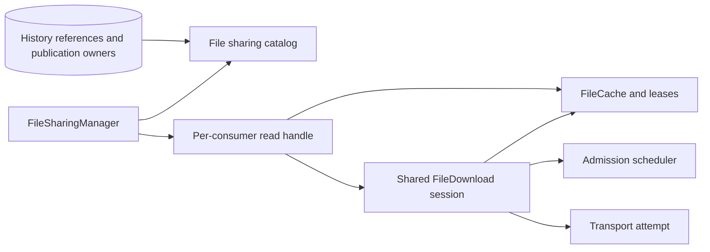
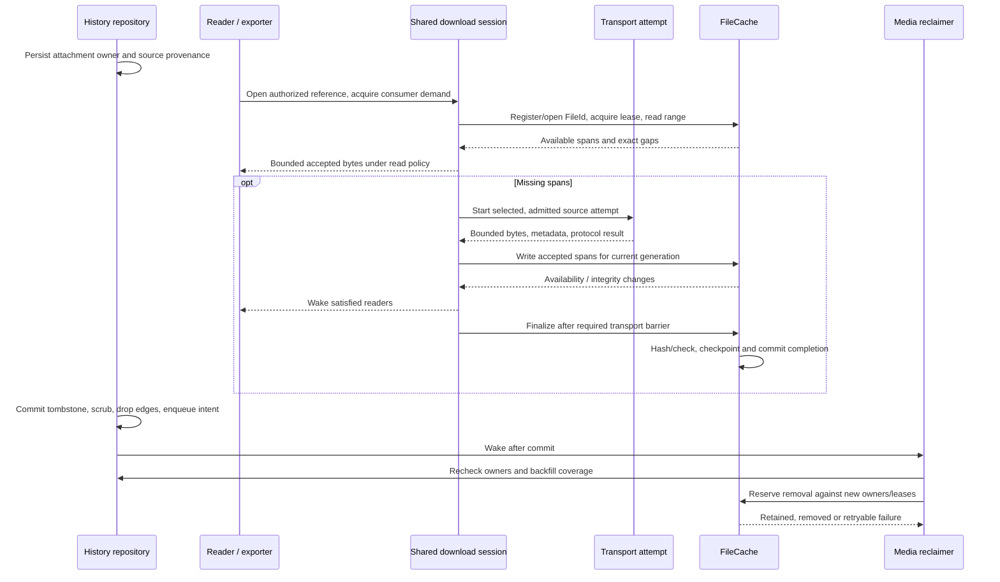

# Local message deletion and shared file ownership

Status: **reviewed design and storage foundation, not a usable deletion feature**.
Initial scope: direct conversations backed by SQLite/MAM. The file access
architecture must also support existing playback, downloads and publication.
Names below describe proposed contracts unless identified as existing.

## User contract and current implementation

Delete locally hides a logical message, including corrections, on this device.
It must survive reconnect, restart, live echo, MAM replay, indexed seek and search.
It sends no stanza and does not delete remote archives or retract a message.
Optional attachment cleanup removes only unshared, application-managed cached
files. It never removes another device's copy, server-hosted media, backups or a
user's original/exported file. UI removal follows a successful history commit.

This PR provides only `HistoryArchive::scrubStoredMessage(db, key, id)`: an
account/conversation-scoped transaction marking an indexed direct content message
and its **currently known** revisions `LocalDeleted`, clearing their plaintext
fields and saved MAM XML, and preserving structural IDs. It rejects protocol-only
events and ambiguous correction components. Reindexing/replay preserve existing
identity aliases instead of rebuilding them from erased content. Replaying the
same stored archive UID cannot refill its scrubbed row.

It does **not** provide durable tombstone aliases, live ingress suppression,
suppression of newly discovered corrections or replacement archive UIDs,
invisible cached-page entries, media ownership, reclamation or a UI action.
A newly arriving revision can still restore visible content; the current cached
page decoder treats empty XML as a cache miss. Do not expose the primitive as
complete local deletion.

## Review of the existing object model

The problem is overlapping lifetimes and authority, not the number of classes.

| Existing code | Observed coupling and consequence |
| --- | --- |
| `FileSharingManager::Private`, `cacheItem`, `item` | Own FileCache, a second MediaChunkCache and FileSharingStore; resolve complete-file pointers across all three. A stored `link` may name the second cache or an external original. |
| `FileSharingItem::download`, `savePublishedFile` | Create transfers, promote files, start hashing and update cache/catalog state. The attachment object's lifetime also owns operations shared by multiple views. |
| `FileShareDownloader::Private`, `readData`, `takeFile` | Couple transport, source fallback, temporary disk writes and promotion handoff; know the manager's cache directory. |
| `FileSharingChunkSource` | A namespace hides per-item Sources and SequentialDownload QObjects using object names. It resolves identity, configures storage, chooses sources, coordinates fallback and wires validation: real session responsibilities behind a stateless-looking API. |
| `MediaChunkCache` / `MediaChunkStore` | Combine read admission, memory caching, range planning and a separately persisted payload registry/quota. `verify()` infers completion from coverage, which alone does not prove final transport success. |
| `FileSharingStore::remember` / `find` | Copy serialized descriptors into rows for each claimed hash, merge sources by hash and retain local paths. This is neither message ownership nor proof of content identity. |
| `FileSharingDeviceOpener`, `FileSharingProxy`, `saveTo` | Independently select cached paths, chunk readers and raw downloaders. Complete-file playback returns a URL without a lease; `close(QIODevice *)` cannot release a pin for that path. |

Moving every responsibility into FileCache would create another oversized object.
Keeping a scheduler and transfer helper does not identify who owns a download.
The missing boundary is an explicit, shared **file access/download session**.
Descriptor persistence is separate from that session and from stored bytes.

## Three identities and lifetimes

| Concept | Identity and lifetime | Owns |
| --- | --- | --- |
| Attachment reference | Stable local logical-message ID plus revision/attachment ID; account and conversation scoped | The message's descriptor, source assertions, filename/caption and ownership edges. |
| Managed file | Opaque FileId assigned before managed bytes arrive; survives restart | One cache entry, payload generation, ranges and verified content aliases. Neither a path nor a URL is a FileId. |
| Download session | Account, resource version, verification requirements and cache generation; exists while work or consumers need it | Demand, attempts, retries, sequential fallback and transport completion evidence, but no disk ownership. |

These identities must not be interchangeable:

- A SIMS-advertised digest is an expected checksum, not a verified global alias.
  Compute and compare bytes before binding it to a blob. Use a computed strong
  digest, initially SHA-256, for cross-account deduplication. A weak compatibility
  alias cannot authorize a global merge or allow one peer to poison another file.
- A hash of an OOB URL names an address, not content. The same URL and size may
  later return different bytes. Account-scoped URL mappings describe a downloaded
  **snapshot**, with validation/version information when available.
- Combining ranges requires consistent expected content identity or a suitable
  strong representation validator. Otherwise use one sequential attempt; restart
  on a changed/failed representation instead of mixing prefixes from attempts.
- Provisional FileIds support unknown size. Unknown and zero are different values.
  EOF establishes size only after protocol success and configured limits.
- The existing earliest `message_revisions.root_id` moves when an older original
  arrives. Assign a stable local logical-message ID independently of that display
  anchor. On identity merges, rebind aliases and ownership edges transactionally,
  retaining redirects for existing handles. The current root is not immutable.

## Target responsibilities

| Entity | Owns / decides | Must not own / decide |
| --- | --- | --- |
| History repository | Logical identity, tombstones, attachment/source edges and cleanup outbox in one SQLite transaction | Payload paths, network attempts or disk eviction |
| File sharing catalog | Account-scoped descriptor/source lookup and reconstruction; a repository view over references and explicit publication records | A second authoritative message descriptor copy, payload availability or GC permission |
| FileSharingItem | Runtime attachment description and observation facade; immutable reference identity, replaceable metadata snapshot | Temporary-file promotion, shared transfer lifetime or an independent availability flag |
| FileSharingManager | Composition/access facade: resolve an authorized reference, acquire a cache handle, attach/create a session | Per-protocol I/O, range arithmetic or independent registries |
| FileDownload | One shared session: demand, source policy, retries, sequential mode, completion barriers and cancellation | Physical cache ownership or message retention |
| FileShareTransport | One selected source attempt; HTTP/FTP, Jingle FT or BoB response metadata, bounded bytes and explicit protocol result | Disk writes, cache paths, switching sources or declaring a whole file complete |
| FileCache | Sole managed-payload owner: registration, range I/O, verification, aliases, leases, persistence, quota and physical removal | URLs, credentials, message parsing, retries, playback policy or Jingle receipts |
| Read handle/device | One consumer's cursor, bounded buffering/lookahead, cancellable tickets and cache lease | Another download, persistent metadata or other consumers' lifetimes |
| Media reclaimer | Consume cleanup intents, resolve current owners and coordinate removal | Guess ownership from paths, catalog presence or one reference counter |

FileDownload is a proposed role/class, not another store. The catalog can initially
retain the FileSharingStore name; renaming alone fixes nothing. Replace copied
incoming-message descriptors with a view over history-owned attachment rows.
Keep explicit publications/imports as separate owners. Source assertions retain
their originating reference: merging by digest must not make a deleted caption,
URL or peer permanent. URL-snapshot bindings use the same scoped reference model.
Tombstones never contain media identities or descriptors.

With history disabled or a no-store policy, received descriptors are transient.
Persistent resume metadata requires a policy permitting it; file caching must not
implicitly enable a second message log. Explicit import, publication and Save As
each have their own ownership/persistence decision.

The consumer API should conceptually provide:

```cpp
// Proposed contracts, not existing declarations.
FileReadHandle openRead(AttachmentId, ReadOptions);
RequestTicket readRange(FileHandle, Offset, BoundedLength, RangeCompletion);
RequestTicket requestMissing(FileReadHandle, ByteRange, Priority);
```

The handle carries a lease, availability/integrity observations and errors.
RangeRead reports available spans and exact gaps in offset order, not disjoint
spans flattened into one byte array. Requests/results have explicit admission
and size bounds. No large-media path calls `FileCacheItem::data()`. A reader asks
the session for gaps; FileCache never fetches. A complete hit needs no transport.
Disk reads and cache hits complete asynchronously on the caller's context.
Accepted requests settle exactly once, including cancellation; admission refusal
is explicit and retains no callback. A QIODevice adapter never blocks readData()
waiting for network or disk work.



### What happens to MediaChunk classes

- Retain MediaChunkScheduler as an internal admission/fairness mechanism used
  by sessions. Single-flight keys include account/resource generation and range
  geometry. Disk hits do not consume network slots. Cancellation removes one
  waiter's demand; an aborted attempt keeps its slot until completion acknowledges it.
- Keep MediaChunkTransfer only as a private bounded attempt-validation helper
  if useful. Protocol response validation belongs at the transport boundary;
  avoid two interpretations of success. Metadata, exact bytes and successful
  termination must agree. EOF or the requested length alone is not success.
- Keep MediaChunkReader's bounded-buffer algorithms behind the common read
  device/handle. Each consumer owns its cursor and tickets, never the session.
- Move MediaChunkStore's disk/range algorithms into a **FileCache-private worker**,
  with no separate registry, quota or public store API. Do not introduce another
  persistent PartialDownloadStore alongside FileCache.
- Remove MediaChunkCache as a second owner after scheduling and memory/range
  responsibilities move to sessions and FileCache. Do not retain bypass APIs
  for storage, availability or deletion.
- Replace FileSharingChunkSource's hidden child-object machinery with typed
  session members. Source scoring and sequential fallback belong to FileDownload,
  metadata lookup to the catalog, payload/range state to FileCache.
- Rename FileShareDownloader to FileShareTransport **after** removing disk writes,
  `takeFile` and `cacheReady`. Keep the account-scoped FileSharingJingleSession
  as a protocol helper used by attempts; do not duplicate its pooling logic.

These are authority boundaries, not one new manager per bullet or a public
inheritance hierarchy. Avoid a mechanical MediaChunk-to-File rename.

## Use cases that define the boundary

| Use case | Required behavior |
| --- | --- |
| Complete cached file, offline | Same facade, no downloader; a lease remains until playback/export ends. |
| Two players, seeking and Save As | Independent cursors/cancellation, shared compatible session and missing-range work, bounded lookahead and fair admission. |
| HTTP ignores Range | One session-wide sequential attempt, not a full GET per waiting chunk. Malformed partial responses are not legitimate range refusal. |
| Sequential fallback reaches an early requested span | Wake satisfied readers before whole-file EOF if streaming policy allows. Full-file export waits for protocol success and required integrity checks. |
| Hashless OOB or no Content-Length | Provisional ID, bounded sequential writes, no advertised content alias or invented random-access size; compute a strong digest at successful EOF. |
| Empty file | Explicit zero size and successful protocol/hash checks. An empty buffer is not sufficient evidence of a cache hit or transfer success. |
| Jingle range or BUNDLE reuse | Preserve range hashes, content acceptance, success/receipt ordering and account/session ownership. Socket bytes do not replace verified protocol completion. |
| Source failure or changed HTTP representation | Retry unsatisfied work only with compatible identity; invalidate the generation/span on integrity failure. Never mix unversioned prefixes. |
| Publish original, paste an image, forward | Originals stay external; generated temporary payloads are cache-owned from creation; publications have explicit holds. Forwarding creates a new reference. |
| Full-file URL or external player | Path optimization still requires a lifetime protocol. The current opener cannot release a URL pin: extend the playback contract, retain proxy serving with leases or retain conservatively. |
| Account removal, view close or decoder failure | Settle affected callbacks once and revoke account capabilities. Closing a view cancels its tickets, not another reader's session or history ownership. |
| One blob shared by two messages/accounts | Remove only the deleted reference and its sources. Preserve bytes needed by another owner/lease; never expose another account's sources or credentials. |

The same access contract serves native playback, HTTP/NAM proxies, automatic
downloads and Save As. HTTP HEAD/range formatting belongs to proxies; user consent
and automatic-size limits belong to caller policy. Neither belongs to FileCache.
Test these adapters, not just helper arithmetic.

## One FileCache, explicit storage state

Register before the first managed write. A metadata-only entry can exist at the
first reference without starting network I/O or allocating its advertised size.
Bound metadata admission too: scrolling history must not create unlimited entries.

Keep independent facts rather than one overloaded `complete` boolean:

- **Availability:** accepted ranges and optional known size.
- **Integrity:** required checksum-span verification and computed content digest.
  Transport-validated bytes are not necessarily hashed.
- **Operation:** active, paused, failed or finalizing belongs to the session;
  the cache records storage/validation consequences and generation.
- **Lifetime:** read/write leases, durable publication holds and removal state.

Complete access requires full coverage, required integrity checks and the
successful transport barrier for that generation. Streaming before a whole-file
hash is known is an explicit caller policy; later failure stops consumers and
invalidates affected spans. Save As commits its QSaveFile only after the full
completion barrier, preserving an existing destination on failure. Exported
output is then user-owned.

FileCache owns the canonical payload and incomplete sidecar from the start.
Completion changes its state, not its cache owner. Verified aliases do not change
FileId. If entries resolve to the same verified content, merge registry ownership
transactionally and keep redirects for active handles. Drain leases before
retiring duplicates; never overwrite a file exposed to a decoder. Temporary
duplicates remain accounted to the same cache and recoverable after restart.

### Checkpoints and recovery

The private worker owns the live range map. Coalesce ordinary dirty sidecar
updates to at most one checkpoint per approximately five seconds per file, with
atomic replacement. Continuous writes still flush periodically. Shutdown, pause
and finalization force checkpoints.

1. Persist registration before exposing managed bytes. Persist payload data
   before advertising its ranges in a durable sidecar. Lost recent coverage
   causes refetch, never a false hit.
2. Before overwriting/invalidating checkpointed ranges, durably withdraw their
   coverage, then change bytes. Nonoverlapping new writes use ordinary batching.
   A failed checkpoint must not leave obsolete coverage trusted.
3. At completion check size, hashes and transport evidence for the generation;
   synchronize data, commit verified-complete registry state, then remove the
   sidecar. Exercise every failure boundary.
4. Sidecar presence requires range-aware access. Absence grants full access
   **only** with a valid committed complete record for that payload generation.
   Missing, damaged, truncated or orphaned files fail closed.
5. On restart validate sidecar bounds, payload identity/size and integrity before
   serving ranges. Sparse file length is not proof of coverage.

QFile::flush and an atomic QSaveFile rename alone are not a complete power-loss
protocol. Specify/test OS and filesystem synchronization boundaries, including
registry replacement ordering. If recovery cannot establish integrity, discard
questionable availability and refetch. Do not advertise unimplemented power-loss
guarantees. Never persist credentials or log bearer URLs as diagnostic IDs.

Disk I/O and hashing run off the UI thread with bounded queues. Hash sequentially
once per completion/verification requirement where possible, not every completed
prefix after every chunk. Bound fragmented range/checksum metadata and coalesce
adjacent spans. Avoid repeated whole-file copying/scanning; one slow hash job
must not block all foreground reads behind an unbounded queue.

### Retention and migration

Unify the 50-MiB FileCache and 256-MiB media cache policies explicitly; do not
silently force media into the smaller quota. FileCache is also used by BoB:
preserve its complete-item API and namespace/policy without adding message or
account semantics to its generic storage implementation.

Leases protect active bytes; durable publication holds protect managed originals
needed for upload serving. Ordinary cache pressure and "remove unshared cached
attachments" are different eviction reasons. History references protect against
the latter; they need not pin every historical download against ordinary pressure
forever. Both use the same physical removal mechanism, honoring leases,
generations and publication holds.

Import media-files-v2 through an idempotent migration journal. Validate versions,
safe paths, size/ranges and hashes; resolve account/source identity; adopt without
unnecessary full-file copying. Preserve useful partial and completed data,
including empty files. Record adoption before dropping old metadata; retire files
after leases drain. Quarantine unresolved entries for bounded recovery instead
of trusting them or deleting the directory blindly.

The old shared-files.sqlite catalog may contain the only publication/local-path
record. Backfill reference-owned descriptors/mappings, migrate actual publication
and external owners explicitly, then remove duplicated rows. A path string is
never proof of cache ownership. Originals and exports cannot become managed
files merely because a descriptor names them.

## Tombstones, identity and ingress suppression

Use persistent identity-only tombstone/alias relations scoped by account,
conversation, direction and ID kind/authority. Trusted archive service plus UID
and origin/client IDs have different trust and ambiguity rules. One history
identity service handles live append, MAM storage and reads. Reused/conflicting
IDs must not authorize deleting unrelated messages.

Keep no body, captions, URLs, media hashes, filenames, HTML or raw stanzas in
tombstones: only suppression identity and structural ordering metadata. Origin
IDs are not globally trusted; do not match by body similarity or sort opaque UIDs.

Check suppression before durable append, media registration and decryption when
identity is already available. For aliases learned only after decrypting, check
again before persistence, display or catalog registration; discard the temporary
decoded payload. Newly learned corrections/aliases join the deleted logical
identity without restoring its content.

HistorySync needs explicit suppressed entries, not fake XML/messages. Preserve
MAM event counts, UID positions and indexed island coordinates while omitting
deleted rows from rendering. A page of suppressed entries is a valid cached
page, not a reason to refetch. Apply the same rule to native archive pages, local
preload, reply resolution, history dialog and search. Invalidate materialized
views, search results and previews after commit.

SQLite updates do not erase old pages, WAL, journals or backups. Evaluate
secure_delete, checkpointing and maintenance separately; never promise physical
secure erasure on SSDs or backed-up storage.

## Ownership transaction and asynchronous reclamation

History owns message_media_refs even when a download never starts. Reuse the
authoritative attachment extractor; audit MessageAttachments::collect's display
policy before using it for ownership. A display-omitted OOB link may still be
referenced elsewhere. Record edges for retained revisions/attachments and
explicit publication owners; resolve provisional files without losing edges.

Deletion is a history operation, not FileSharingItem::delete():

1. Resolve a nonambiguous logical identity in the caller's account/conversation.
2. In one SQLite transaction, record suppression aliases, collect file IDs,
   remove the message's ownership/source edges, scrub revisions and MAM XML,
   and enqueue idempotent cleanup intents.
3. Commit, then update views. Network I/O and another cache database are outside
   this transaction. Reference-owned descriptor metadata must be scrubbed in
   the same history database, avoiding a second retained message copy.
4. Perform requested byte reclamation asynchronously. Deletion remains committed
   if unlink fails. Report logical removal separately from pending/failed cleanup.

Backfill old ownership in bounded batches with a durable coverage watermark.
Until every relevant store/account is covered, **retain questionable payloads**:
a missing edge is not proof of no owner. Include publication holds, pending
exports and readers. Catalog presence and a mutable published flag are not proof.

For each intent, re-resolve verified aliases and current owners across accounts.
Coordinate a removal reservation with FileCache: owner/session/lease acquisition
must serialize against it. Checking two independent databases and then unlinking
is unsafe. New references either cancel/reject the reservation or observe the
removed entry and use a new generation. Old callbacks cannot recreate it.

Persist the removal intent/generation before physical deletion and reconcile it
on startup before accepting conflicting operations. Route history owner changes
and session/lease acquisition through the same coordinator; publication and
import paths cannot bypass it. Recheck the owner revision while holding the
reservation. After a crash, an unfinished reservation is reconciled against both
the owner ledger and the cache, never treated as proof that a file was removed.

FileCache removes only paths it generated in its managed namespace, payload and
sidecar together. Never cancel another reader just to make cleanup succeed.
Distinguish retained-shared, retained-pinned, removed and failed; sharing violations
remain retryable after restart. Remove scoped URL/source bindings without
affecting another account. Retrying an intent cannot resurrect a message.



## Delivery stages and acceptance tests

Keep this PR draft until its chosen implementation stages are explicit. Design
review is not evidence that the downloader refactor or deletion feature exists.

1. **History identity/visibility.** Durable aliases and stable logical identity,
   scrubbing, live/MAM checks and invisible entries. Test correction-before-original,
   future corrections, new archive UIDs, ambiguous IDs, restart, rollback, both
   directions and account/conversation isolation. Cover history/search/reply adapters.
2. **Common access facade and leases.** Route consumers through handles before
   changing persistence. Introduce explicit sessions while preserving bounded
   scheduling/validation. Test two readers plus export, independent cancellation,
   sequential early-range delivery, direct-path lifetime and account removal.
3. **Single-cache storage and transport separation.** Move range persistence into
   FileCache, remove downloader disk writes/second cache, migrate legacy files
   and catalog ownership. Test empty/unknown-size files, restart at each commit
   boundary, damaged sidecars, invalidation-before-overwrite, quotas, merges,
   large-file memory/I/O bounds, HTTP no-Range and real Jingle completion.
4. **Ownership/reclamation.** Record edges on all history ingress paths, backfill
   old rows/publications, add outbox/removal reservations. Test shared blobs and
   accounts, hash aliases, deleted source assertions, originals, interrupted
   migration, pinned paths, new-owner races and stale callbacks.
5. **UI gates.** Enable Delete locally only after stage 1 and reference-metadata
   scrubbing. Enable optional byte reclamation only after stages 2-4. Persistence
   precedes visible removal; verify no XEP-0424 stanza. Default to keeping bytes.

Retain the existing HistoryArchiveTest and filesharing filestore, chunkcache,
chunkscheduler, chunktransfer, mediasave, httpranges, simshistory, hashjob,
publication and jinglesession coverage. Helper tests do not prove end-to-end
no-Range fallback, path leases, history ownership or safe GC. Add tests at those
boundaries before removing old paths; do not equate helper coverage to a
completed delivery stage.

Protocol references: [corrections (XEP-0308)](https://xmpp.org/extensions/xep-0308.html),
[ID authority (XEP-0359)](https://xmpp.org/extensions/xep-0359.html),
[MAM identity/paging (XEP-0313)](https://xmpp.org/extensions/xep-0313.html), and
[remote retraction (XEP-0424)](https://xmpp.org/extensions/xep-0424.html).
Local suppression is client storage policy, not remote retraction.
