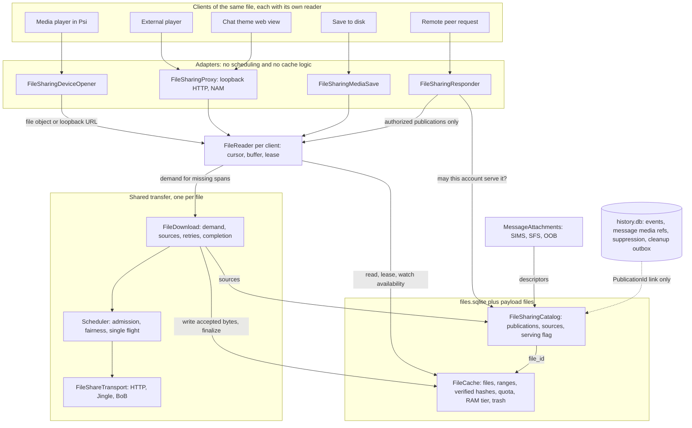
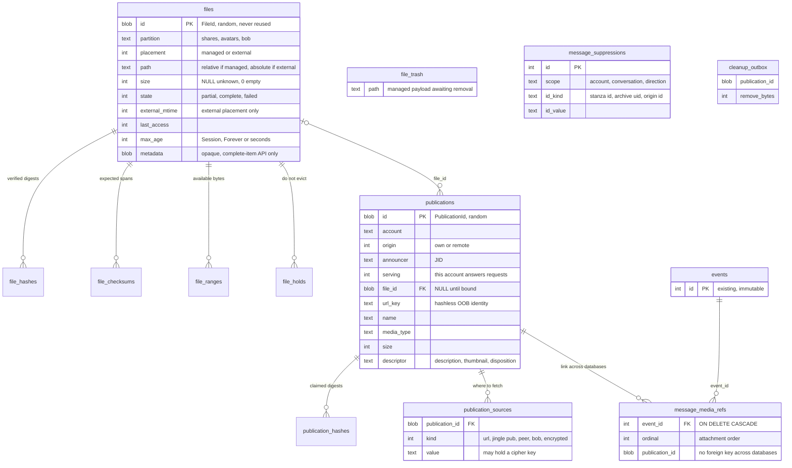
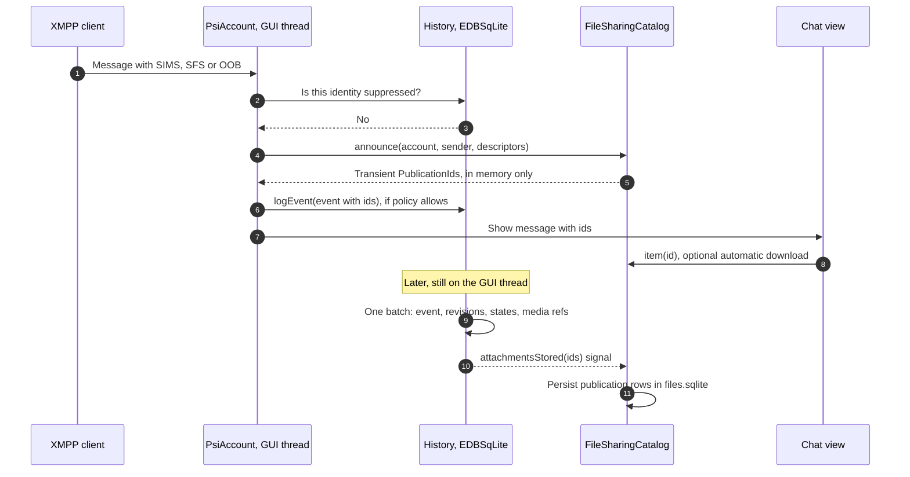
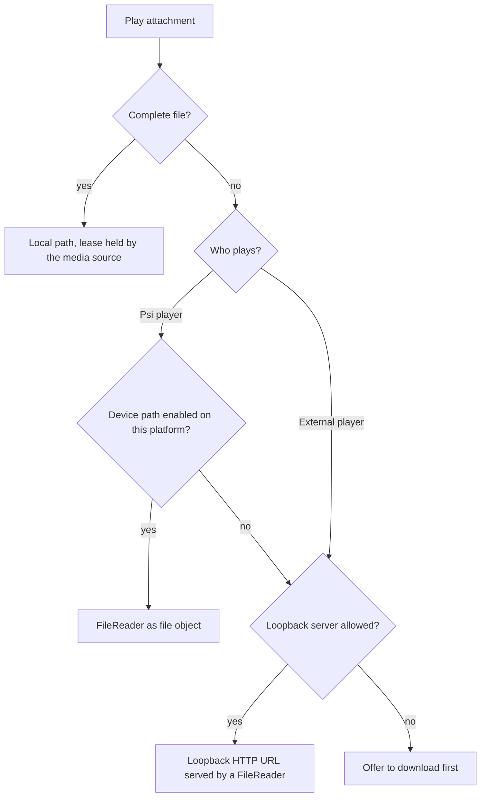
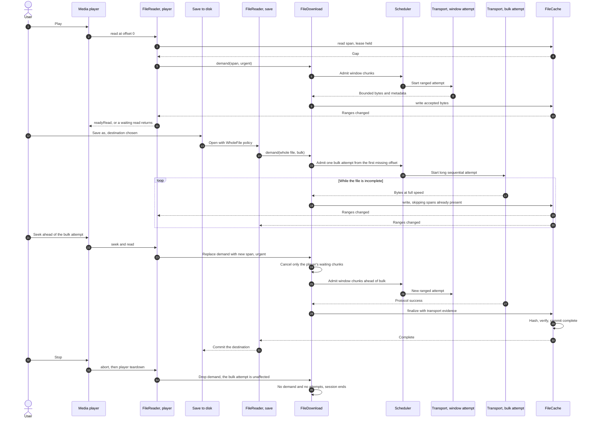
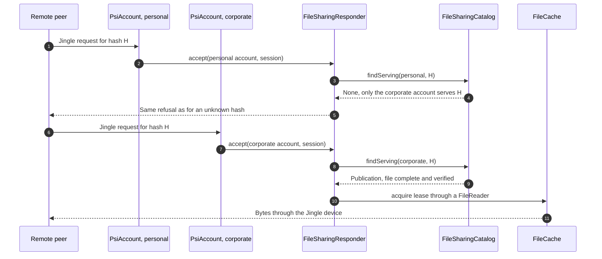
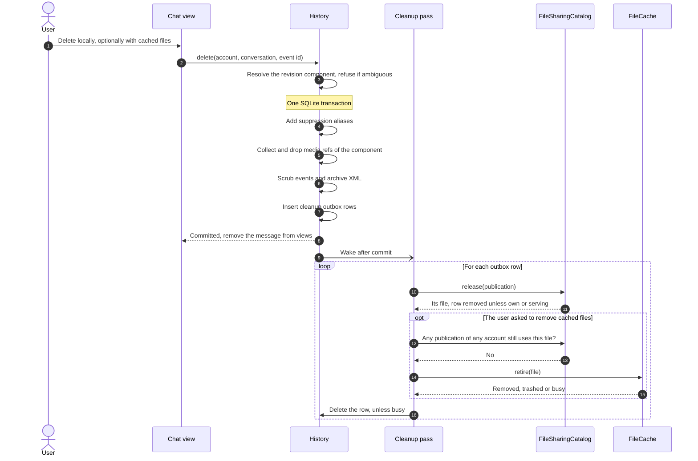
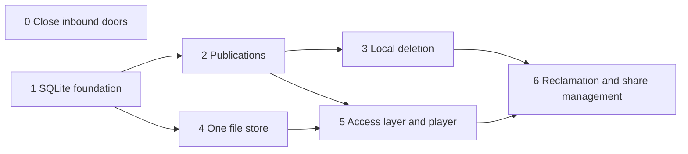

# Shared files, publications and local message deletion

Status: **design**. The only delivered part is `HistoryArchive::scrubStoredMessage`,
a storage primitive for stage 3. Names below are proposed unless marked *existing*.
Local deletion initially covers direct conversations backed by SQLite/MAM. The file
architecture covers every chat type, playback, downloads, publishing and serving.

## Decisions

1. **One physical copy per profile, one sharing decision per account.** Bytes are
   deduplicated across accounts of a profile. Whether a file is shared is decided by
   each account separately, so corporate data cannot leak through a personal account.
2. **Serve only what this account published or joined.** A remote request is answered
   only if the receiving account published the file, or the user agreed to join the
   publication of a file already downloaded through SIMS or SFS. Everything else is
   refused, including files that happen to be in the cache.
3. **File records and publications live in SQLite.** Own and remote publications,
   their sources, file records and the former range sidecars are tables. History and
   every other location store only a link to a record.
4. **In-place shares are links.** A file shared where it already lies is referenced by
   path, is never deleted by the cache and does not count against the quota.
5. **Large downloads ask where to go.** A non-streaming download larger than half of
   the cache quota asks for a destination first and writes there directly.
6. **The player consumes a file object.** Scheduling and chunk caching start from the
   reader the player holds. Loopback HTTP is a second presentation of the same reader
   and can be switched off where a local server is not allowed.
7. **A file that cannot be removed goes to the trash.** It becomes unreachable at once;
   removal is retried at the next start or at another suitable moment.

The user contract for deletion: *Delete locally* hides a logical message, including
corrections, on this device. It survives reconnect, restart, live echo, MAM replay,
indexed seek and search. It sends no stanza and does not delete remote archives or
retract a message. Optional cleanup removes only unshared, application-managed cached
files; it never removes another device's copy, server-hosted media, backups, or a
user's original or exported file. UI removal follows a successful history commit.

## What is wrong today

| Existing code | Observed behaviour | Consequence |
| --- | --- | --- |
| `FileSharingManager::acceptIncomingDownloadContents` | Looks a requested hash up in the global cache and global item map. `setRemoteJidChecker` is never called, so `isAllowedParty` is always true. | Anyone with a full JID and a hash receives any cached file, including one downloaded by another account. Reads use a raw `QFile`, outside any lifetime control. |
| `JT_BoBServer`, `BoBFileCache` | One cache singleton behind every account's `BoBManager`; any cached cid is returned. | The same leak for Bits of Binary. |
| `shares/`, `avatars/`, `bob/` | Located under the home directory, unlike per-profile `history/`. | Instances running different profiles rewrite the same `cache.xml`. The profile lock protects none of these directories. |
| `FileCache` | Hash-keyed; `cache.xml` is rewritten whole on a timer; complete items only; `AvatarCache` subclasses it and walks `_items`. No tests. | Nothing can be transactional. Any change risks avatars and BoB unprotected. |
| `MediaChunkStore` | A second payload registry and quota. The JSON sidecar is rewritten twice per write; `initialize()` rehashes checksummed files on every start; `verify()` infers completion from coverage. | Two owners of bytes, write and start-up cost, and no proof of transport success. |
| `FileSharingManager` | Owns all stores, follows `link` across them, builds message HTML, serves peers and creates outgoing items. Its own comment calls it a "magic class". | No answer to "who is responsible for what". |
| `FileSharingItem` | Creates transfers, promotes files, hashes, publishes, sends HEAD, decides automatic downloads. Parented to the manager and never destroyed. | Unbounded growth, and a UI object that owns shared operations. |
| `FileShareDownloader` | Contains a good private strategy hierarchy, `AbstractFileShareDownloader`, wrapped by a class that adds source fallback, temporary disk writes and promotion. | Transport is coupled to storage. |
| `FileSharingChunkSource` | A namespace hiding per-item `Sources` and `SequentialDownload` QObjects behind object names. | Session state with no visible owner. |
| `FileSharingStore`, `fillMessageView`, `appendEvent` | Merge descriptors per hash and write them on display and on log, regardless of `opt_log`. | A deleted URL or peer stays forever, and history-disabled accounts still get a message log. |
| `FileSharingDeviceOpener`, `FileSharingProxy`, `saveTo` | Independently pick cached paths, chunk readers or raw downloaders. | Three read paths and no shared session. |
| `ITEMediaOpener` in `3rdparty/qite` | `close()` is called only for devices, and only after the player is destroyed. | No release for paths, and a GUI hang on Qt 6 with a waiting device (see [measurements](#measured-backend-behaviour)). |
| `PsiAccount::handleEvent`, `logEvent` | The history write is only queued; the view renders and may auto-download at once. Group chat messages are not logged live, and `opt_log` may disable logging. | A history row cannot be the key for reading. |

## Vocabulary

| Term | Meaning |
| --- | --- |
| **File** | One record in `FileCache`: payload location and facts about it. Identified by an opaque `FileId`. Knows nothing about messages or accounts. |
| **Publication** | Someone's announcement that a file can be obtained: descriptor plus sources. *Own* publications are ours; *remote* ones arrived in a message. Identified by an opaque `PublicationId`, scoped to one account. |
| **Serving** | A flag on a publication: this account answers remote requests for it. Set by publishing or joining. |
| **Message media ref** | A history row linking one attachment of one stored event to a publication. |
| **Download** | `FileDownload`, the shared runtime session filling one file. |
| **Attempt** | One `FileShareTransport` talking to one selected source. |
| **Reader** | `FileReader`, one client's file object: cursor, bounded buffer, lease. |
| **Lease** | In-memory: these bytes are in use right now. |
| **Hold** | Durable: do not evict this file. |
| **Retire** | Make a file unreachable, then remove its managed payload. |
| **Partition** | One quota, retention policy and payload root in `FileCache`: `shares`, later `avatars`, `bob`. |
| **Suppression record** | Identity-only history row hiding a deleted message. XEP-0424 uses "tombstone" for a server-side archive entry, so that word is avoided here. |
| **Cleanup outbox** | History rows written in the deletion transaction and consumed after commit. |

## Who answers what

| Question | Answer | Must not know |
| --- | --- | --- |
| Where are the bytes? Are they complete and verified? | `FileCache` | Accounts, JIDs, URLs, messages, Jingle, retries, playback |
| What was announced, by whom, from which sources? Does this account serve it? | `FileSharingCatalog` | Bytes, attempts |
| Which message refers to which publication? Which messages are hidden? | History: `EDBSqLite`, `HistoryArchive` | Paths, file state, sources beyond its own message snapshot |
| What does this stanza attach? | `MessageAttachments`, pure functions over SIMS, SFS and OOB | Storage, policy |
| How do bytes arrive from one source? | `FileShareTransport`: HTTP, Jingle or BoB | Disk, other sources, whole-file completion |
| Who is filling this file right now? | `FileDownload` with the shared scheduler | Messages, players, cache internals |
| Where is this client in the file? | `FileReader` | Other clients, persistence |
| How is our own file announced? | `FileSharingPublication` | Cache internals |
| May this remote request be served? | `FileSharingResponder`, asking the catalog | History |
| What does this attachment look like right now? | `FileSharingItem`, a replaceable observer holding no source of truth | Transfers, storage |
| Should this run automatically, and where should it go? | Caller policy: `MediaDownloadPolicy`, dialogs | Everything below |
| Who wires it together? | `FileSharingManager`: owns the services and the runtime maps of downloads and items | SQL, protocols, range arithmetic |

File sharing talks XMPP in four places: `MessageAttachments` parses, `FileSharingPublication`
announces, `FileSharingResponder` serves and `FileShareTransport` fetches. Storage is
handled in one place. Each consumer is a thin adapter over one `FileReader`.



`FileCache` never fetches, and a complete file needs no download. A reader of a complete
file talks to the cache alone, including offline. A download never talks to readers: it
writes, the cache announces availability, and waiting readers wake up. That single
direction is why an early span of a sequential transfer reaches a player without any
special case.

## Data model



`files.sqlite` is one per profile and uses WAL. A small `FileDatabase` opens it and
migrates the schema. `FileCache` owns the `file*` tables and `FileSharingCatalog` owns
the `publication*` tables; foreign keys point from publications to files, never back.
`publications.file_id` uses `ON DELETE SET NULL`. If the database cannot be opened, the
cache runs without persistence for the session, as `FileSharingStore` already does.

**Everything moves under the profile.** The store assumes one process per profile.
`ActiveProfiles` enforces that with its D-Bus and Windows backends, and only for per-profile
paths, so today's home-level directories do not qualify. The stub backend (macOS, Haiku, Linux
without D-Bus) enforces nothing. A second instance on one profile there keeps SQLite consistent
but does not see the first one's leases, and the worst outcome is a refetch.

**One publication per announcement.** Each attachment of each stored message has its
own publication row. Deleting a message therefore removes exactly its caption, URL and
peer without provenance bookkeeping. Siblings are found by query: publications of the
same account claiming the same digest (and the same size, when both declare one), or
the same `url_key` for hashless OOB. A download takes the union of sibling sources, and
binding a file updates all siblings in one statement.

**Random identifiers.** A recreated `files.sqlite` cannot make an old history link point
at a different file. A payload name derived from `FileId` is never reused, so a late
removal cannot hit a new file.

**History keeps links to rows of its own events.** `events.id` is immutable, and
`message_revisions` already groups a message's revisions. A media ref per event row with
`ON DELETE CASCADE`, following `message_state_refs`, needs no stable logical-message ID,
no identity merging and no redirects. `events.extra_data` keeps its protocol snapshot,
which is what makes the catalog rebuildable.

### Consistency across the two databases

There is no cross-database transaction, and none is needed:

- **A link without a publication** (database lost, write failed) is healed when read: the
  event's `extra_data` recreates the row under the same ID.
- **A remote publication without a link and not serving** (crash before the history
  commit, erased contact) is removed by the start-up sweep.
- **A deletion** is committed in history with its outbox rows, then released in
  `files.sqlite`. The outbox replays at start before networking.

## From message to publication

The answer to "what can be read before history has the row" is to name the attachment on
the GUI thread *before* handing the message to history. Nothing is written to disk at
that point, so caching cannot become a second message log.



- **History-disabled or no-store policy:** publications stay transient. A file bound only
  to transient publications uses the existing `Session` retention.
- **Live group chat:** not logged, so transient until MAM stores the message. MAM creates
  its own publication; both resolve to one file by digest.
- **MAM:** `HistorySync` announces in `parseResults` through its `Context`, once a message
  is decoded. `storePage` writes refs for rows it really inserted. Rows it reuses keep
  their refs, and live deliveries matched by `matchingDelivery` persist nothing.
- **Transient entries** live while an item or a queued event uses them; the rest are bounded
  by an LRU. An evicted one is announced again from the message, so no information is lost.
- **Stored messages** get their IDs from media refs, not by announcing again.
- **Display never persists anything.** The writes in `fillMessageView` and `appendEvent`
  disappear, and with them history's upward call into the manager: history only emits a
  signal.

`<share>` markup, `share:` URLs and proxy paths carry a `PublicationId` instead of a hash.
Deleting a publication therefore revokes its URLs.

`MessageAttachments::collect` stays pure and grows SFS support (iris already parses it).
Its display policy needs one audit: an OOB URL inside other text is an ordinary link, not
an attachment, and stays that way for refs too.

## Reading a file

### FileReader

Every client uses one public type:

```cpp
// Proposed contract.
class FileReader : public QIODevice {
public:
    enum class Policy { Stream, WholeFile }; // Stream may read before whole-file integrity is known.
    bool   isSequential() const override;    // False whenever the size is known.
    qint64 size() const override;
    bool   seek(qint64 pos) override;        // Moves demand. Never waits.
    void   abort();                          // Any thread. Wakes a waiting backend; reads return -1.
signals:
    void failed();
};
FileReader *FileSharingManager::openReader(PublicationId, FileReader::Policy, QObject *parent);
```

Spans, gaps and tickets stay private between reader, download and cache. A consumer never
runs a "read, find the hole, request it" loop.

Rules for `readData()`, derived from the measurements below:

- **On the reader's own thread it never waits.** A gap returns 0, and `readyRead` follows.
- **On a foreign thread a gap waits** on a condition variable until the span arrives, the
  download fails or `abort()` is called. It never returns 0 for a gap.
- **A reader is seekable whenever the size is known.** Unknown size means sequential.
- **The foreign-thread path touches only state behind the reader's mutex,** and the owner
  does not call cursor methods meanwhile.
- **`abort()` comes before tearing down the player.** Always.

### Measured backend behaviour

Measured on Linux on 2026-11-01 with a scratch probe that plays WAV, M4A with `moov` at the
end and Ogg Opus through a device whose data arrives late. Stage 5 turns it into a test.

| Backend | Thread calling `readData` | `readData` returns 0 on a gap | Waiting inside `readData` |
| --- | --- | --- | --- |
| Qt 5.15, GStreamer | GUI thread | Works: resumes on `readyRead`, all formats | Deadlocks the GUI |
| Qt 6.10 and 6.12, FFmpeg | Backend worker thread | Unusable: about 20 million calls in 2.5 s, and depending on format "Could not open file", "Invalid data" or playback silently truncated at the gap | Works for all formats, with a handful of reads in total |

On Qt 6, `stop()`, `pause()` and `setPosition()` return immediately while the backend
waits. **Destroying the player or resetting its source hangs the GUI thread until the read
returns** (killed after 12 s in the probe); with `abort()` first both take at most 1 ms. A
sequential device fails on M4A with `moov` at the end on Qt 6, though not on Qt 5. The
non-blocking and blocking cases need no backend detection: the thread check covers both.

qite already hands a device to the player, through `setMedia(url, stream)` on Qt 5 and
`setSourceDevice` on Qt 6. Today only builds without the web server use that path, and their
`FileShareDownloader` returns 0 on a gap, which the table shows is unusable on Qt 6.

Not yet measured: the Qt 6.4 baseline, Windows and macOS. The device path stays off on a
platform until the probe passes there.

### Choosing the playback source



Both `reader` and `http` start the same scheduling, because both are one `FileReader`.
The choice is one function in `FileSharingDeviceOpener`, with one option to force it.

The qite contract changes in `3rdparty/qite`, so that a path, a URL and a device have the
same lifetime:

```cpp
// Proposed. The player owner keeps this for the whole playback.
class ITEMediaSource {
public:
    virtual ~ITEMediaSource();       // Releases the lease.
    virtual QUrl       url() const = 0;
    virtual QIODevice *device() const = 0; // nullptr for a path or URL.
    virtual void       abort() = 0;  // Called before the player is destroyed or reset.
};
virtual std::unique_ptr<ITEMediaSource> ITEMediaOpener::open(const QUrl &url) = 0;
```

An external player that Psi starts is tracked as a child process instead of
`QProcess::startDetached`, and the lease ends when it exits. Over HTTP the proxy's reader
ends with the connection. Nothing can be promised for a program Psi did not start, and
the [trash](#retention-removal-and-trash) covers that case.

### Two clients of one file

A media player and a fast save to disk on the same file, sharing one download:



A session holds at most one **bulk attempt**, for whole-file demand, plus a bounded number
of **window attempts** for interactive readers. Single flight works on the existing chunk
grid, so a span is fetched once. Cancelling removes one reader's demand; it does not stop
work another reader needs. An aborted attempt keeps its scheduler slot until completion
acknowledges it. Disk hits consume no network slots.

If the server ignores Range, the bulk attempt is the only attempt, and a seek past it waits
for it. If the file is below the destination threshold, the save job waits for the
completion barrier and then copies; above it, the file is written directly to the
destination (see [large files](#large-files)).

### Transfer and identity rules

- A SIMS or SFS digest is an expected checksum, not a verified alias. Compute and compare
  bytes before recording it in `file_hashes`. A publication whose claims fail stays unbound
  and reports an integrity error, without invalidating the file for its siblings.
- A hash of an OOB URL names an address, not content. A binding is a downloaded snapshot,
  with validators when available.
- Combining ranges requires a consistent expected digest or a strong representation
  validator. Otherwise use one sequential attempt. If the representation changes, retire
  that `FileId` and start a new one; a stale attempt cannot write to a retired file.
- Unknown and zero sizes differ. EOF establishes a size only after protocol success and
  configured limits. Hashless OOB and missing Content-Length mean sequential writes, no
  invented random-access size, and a strong digest computed at successful EOF.
- Metadata, exact bytes and successful termination must agree. EOF or the requested length
  alone is not success. `MediaChunkTransfer`'s checks become the transport base logic, so
  there is one interpretation of success.
- Jingle keeps range hashes, content acceptance, receipt ordering and account ownership.
  Socket bytes do not replace verified protocol completion. `FileSharingJingleSession`
  stays the account-scoped pool.
- BoB payloads are small and complete, and the transport treats them as one attempt.
- XEP-0448 encrypted sources are consumed through a decrypting transport. AEAD cannot be
  verified piecewise, so they are sequential.

### Use cases

| Use case | Behaviour |
| --- | --- |
| Complete cached file, offline | Reader and cache only. No download, no network. |
| Two players and a save | Independent cursors and cancellation, one download, fair admission. |
| HTTP ignores Range | One session-wide sequential attempt, not a full GET per chunk. A malformed partial response is a failure, not a Range refusal. |
| Sequential transfer reaches a requested span early | Readers wake on availability. `WholeFile` still waits for completion. |
| Empty file | Explicit zero size and successful protocol and hash checks. |
| Source failure | Retry unsatisfied work only with compatible identity; on integrity failure withdraw the span. |
| Publish original, paste an image, forward | Originals stay external. Generated payloads are managed from creation and held by their publication. A forward creates a new publication. |
| Account removal, view close, decoder failure | Callbacks settle once and account capabilities are revoked. Closing a view cancels its demand, not another reader's work. |
| One file in two messages or accounts | Deleting removes that publication and its sources. Bytes stay while any publication, hold or lease needs them. |
| Web view, proxy | HEAD and Range formatting belong to the proxy. Consent and size limits belong to caller policy. Neither belongs in the cache. |

Accepted requests settle exactly once, including cancellation. Admission refusal is
explicit and retains no callback. No large-media path calls `FileCacheItem::data()`.

## FileCache

`FileCache` keeps its name and becomes the single owner of managed payload per partition.
It avoids becoming a God object by keeping one small facade over private parts:

- **`FileDatabase`:** schema, migration and one connection per thread.
- **Private worker on its own thread:** payload I/O, range merging, hashing, checkpoints
  and unlinking. It takes over `MediaChunkStore`'s `DiskWorker` algorithms.
- **Facade on the GUI thread:** leases, eviction decisions, retire, RAM tier and
  availability signals.

Two API surfaces share one table. The **complete-item API** (`append`, `moveToCache`, `get`,
`remove`) keeps its contract for avatars and BoB. The **file API** is what readers and
downloads use:

```cpp
// Proposed; private to reader, download and catalog.
FileId       create(Placement, std::optional<quint64> size);  // At first demand, not at first reference.
FileId       adoptExternal(const QString &path);              // In-place share.
Lease        acquire(FileId);
Ticket       read(const Lease &, quint64 offset, quint64 bounded, RangeCompletion); // Spans and exact gaps.
Ticket       write(FileId, quint64 offset, QByteArray bytes, Completion);
void         finalize(FileId, TransferEvidence, FinalizeCompletion);
FileRanges   ranges(FileId) const;
RetireResult retire(FileId);
void         rangesChanged(FileId);                           // Signal.
```

Disk reads and cache hits complete asynchronously on the caller's context. `read` and
`write` always run on the worker; `acquire` and `retire` run on the GUI thread, which makes
them atomic against each other and against history queries.

### Independent facts

- **Availability:** `file_ranges` and an optional known size.
- **Integrity:** `file_checksums` required, `file_hashes` computed.
- **Operation:** active, paused and retrying belong to the download. The cache records only
  storage and validation consequences.
- **Lifetime:** leases in memory, `file_holds` on disk.

Complete access requires full coverage, the required integrity checks and the successful
transport barrier. Streaming before a whole-file hash is known is an explicit reader
policy; a later failure stops readers and withdraws the affected spans. Save As commits
only after the barrier, preserving an existing destination on failure. Exported output
is then user-owned.

Sparse payload length is never proof of coverage.

### Durability

Coverage rows replace sidecars; there is no lifecycle of separate files to keep in order.

1. Write bytes, synchronize the payload, then commit coverage in a transaction. Commits are
   coalesced to about one per five seconds per file and forced on pause, close and finalize.
   A lost commit causes a refetch, never a false hit.
2. Before overwriting a checkpointed range, commit its withdrawal first.
3. At completion check size, hashes and transport evidence, synchronize the payload, then in
   one transaction set `complete`, insert verified hashes and drop range rows.
4. At start check existence and size of complete files and clip partial ranges to the
   payload length. Verified facts are persistent, so nothing is rehashed at start;
   verification repeats only on demand. Missing or damaged payloads fail closed.

`QFile::flush` alone is not a power-loss protocol. Specify and test the synchronization
boundaries, and do not advertise guarantees that are not implemented. Never persist
credentials in logs or use bearer URLs as diagnostic IDs. Hash once per requirement, not
per chunk, off the UI thread with bounded queues. Bound fragmented range and checksum rows
and coalesce adjacent spans.

### Placement

| Placement | Path | Counted in quota | Removed by the cache |
| --- | --- | --- | --- |
| Managed | Inside the partition root, named from `FileId` | Yes | Yes |
| External | Absolute, with size and modification time recorded | No | Never |

An external file is validated against its recorded size and modification time before
reading. If it changed, its publication reports that instead of serving other bytes. A path
is never proof of ownership, and an original cannot become managed because a descriptor
names it.

### Large files

A non-streaming download larger than half of the `shares` quota first asks for a destination,
as a rule in `MediaDownloadPolicy`. The file is then written to `<destination>.part` with
external placement and renamed at completion, so nothing is written twice, the quota is
unaffected and an existing destination survives failure. A player started meanwhile reads
the same record. Automatic downloads never start above this limit, whatever the configured
automatic size. Streaming stays in the cache: a leased file may exceed the quota and becomes
the first eviction candidate after release.

An unknown size counts as small until it crosses the limit. The transfer then fails with an
offer to save to a destination; a partial file does not migrate in the first version.

### Retention, removal and trash

Each partition has one quota, so `shares` replaces the separate 50-MiB and 256-MiB limits
with one setting (default 256 MiB). Partial ranges and complete sizes count together. Eviction
takes expired files first, then the least recently used, skipping leased, held and external
files.

History references do not pin a file against ordinary pressure, and a file referenced only
by history may disappear and be fetched again. A user who wants to keep a file saves it. Only
publishing or joining adds a hold.

Retiring removes the row and its dependent rows and inserts the payload path into `file_trash`
in one transaction, then unlinks. Publications fall back to `file_id = NULL` through the foreign
key. If unlinking fails, for example a Windows sharing violation under a player Psi does not
control, the path stays in `file_trash`. Removal is retried at the next start, when a lease
ends and during idle maintenance. A managed file without a row is an orphan and is removed by
the same pass; only paths the cache generated in its own root are ever touched.

### RAM tier

Bounded memory for the hottest content lives in the cache: recently read chunks and small
complete files, replacing `MediaChunkCache::memory_` and `FileCacheItem::_data`. This is what
makes scrolling history fast after `FileSharingItem` objects are gone.

### FileSharingItem lifetime

An item is created on demand from the catalog and lives no longer than the materialized
messages that need it: rows and `MessageView` hold strong references, the manager keeps a weak
map. Dropping an item is always safe, because it owns no source of truth, and any active
reader, download or publication job holds its own reference.

## Publishing and serving



- **Publishing own files.** `FileSharingPublication` gathers sources (HTTP upload, Jingle
  publication) and the catalog records an own publication with `serving = 1`, persisted at once
  because it is an explicit user action. In-place files get external placement. Generated
  payloads are managed and held.
- **Joining.** The user agrees to serve an already downloaded remote file. This requires a
  complete file with all announced hashes verified: XEP-0447 forbids announcing oneself before
  that, and advises against it without hashes. Joining sets `serving = 1`, adds a hold and
  registers a Jingle publication. With SFS it may also send a source attachment; with SIMS
  it only answers hash requests.
- **Serving.** XEP-0234 hash requests and XEP-0358 publications both go through
  `FileSharingResponder`, and each opens a `FileReader`. Partial files are never served.
- **Management.** The catalog lists serving publications per account, and a settings view
  publishes, joins and unshares. Unsharing clears the flag, removes the hold and unregisters
  the Jingle publication. Deleting a message does not unshare.

Security rules:

- **Unknown and not-shared-here are indistinguishable** for the requester: the same Jingle
  reason, and `not-acceptable` for XEP-0358.
- **An account reads a file only through its own publication.** `file_hashes` is used to
  deduplicate at finalize, never to grant access. Physical deduplication therefore does not
  change an account's behaviour: an account fetches a file it has not obtained itself, even
  if another account already cached the bytes, and the copies become one at completion. A
  hostile sender on a personal account cannot learn from a missing fetch what a corporate
  account holds.
- **An unverified partial file** is reachable only through publications of the account
  filling it.
- **Only strong digests deduplicate** (initially SHA-256). A weak alias cannot merge files or
  let one peer poison another's file.
- **Without usable hashes,** per XEP-0447, ignore sources attached by others and insecure
  sources. Do not fetch `disposition='attachment'` without user interaction. Asking before
  revealing an address to an untrusted party remains caller policy.
- **BoB follows the same rule:** a request on one account must not return data cached through
  another.
- **Cipher keys** in `publication_sources` have the sensitivity of the message: they go away
  with the publication and never reach logs.

## Local deletion

### Suppression

Suppression records are identity-only, scoped by account, conversation, direction and ID kind
or authority. They hold no body, caption, URL, media hash, filename, HTML or raw stanza. Trusted
archive service plus UID and origin or client IDs have different rules: XEP-0359 calls origin
IDs spoofable, and archive IDs are opaque, so never sort them or match by body similarity. The
logic lives in `HistoryArchive` functions shared by live append, MAM storage and reads.
Reused or conflicting IDs must not authorize deleting unrelated messages; `scrubStoredMessage`
already refuses ambiguous components.

Check suppression before announcing, durable append and decryption when identity is already
known, and again before persistence or display for aliases learned after decrypting; discard
the decoded payload then. XEP-0308 makes every correction reference the original `id`, so a
correction joins by its target. When a correction adds an alias, rows already stored under that
alias are scrubbed too. The check repeats inside `appendEvent`, because a write may be queued
while a deletion commits.

`HistorySync` needs explicit suppressed entries, not fake XML. Preserve MAM event counts, UID
positions and indexed island coordinates while omitting deleted rows from rendering. A page of
suppressed entries is a valid cached page, not a reason to refetch, whereas today an empty XML
is a cache miss. Apply the same rule to archive pages, local preload, reply resolution, the
history dialog and search, and invalidate materialized views after commit.

SQLite updates do not erase old pages, WAL, journals or backups. Evaluate `secure_delete` and
checkpointing separately, and never promise physical erasure.

### The delete operation



The owner check and `retire` are synchronous calls on the GUI thread, with no return to the
event loop in between. No other thread creates owners or leases, and a profile has one process,
so no reservation protocol or second journal is needed. A crash replays the
outbox, and every step is idempotent. Retiring a file wrongly cannot be worse than ordinary
eviction, which is allowed at any time: the next demand fetches again, and new owners simply
create a new `FileId`. A message still in the write queue may be missed by the check, with the
same outcome.

The UI reports logical removal separately from file outcome: removed, kept because another
owner uses it, pending because it is in use, or moved to the trash. Deletion stays committed
whatever happens to the file, and retrying cannot resurrect a message. Bytes are kept by
default. BoB thumbnails expire by their own TTL; the first version does not chase them.

## What happens to existing classes

| Existing | Target |
| --- | --- |
| `FileCache`, `FileCacheItem` | `FileCache` as above, on SQLite. `cache.xml` goes away. |
| `MediaChunkStore`, its `DiskWorker` | Algorithms move to the private worker. Class, directory and sidecars go away. |
| `MediaChunkCache` | Removed. Memory goes to the RAM tier, demand and single flight to `FileDownload`. |
| `MediaChunkReader` | Becomes `FileReader`, keeping its bounded buffer and lookahead. |
| `MediaChunkScheduler` | Stays, one instance owned by the manager and used by downloads. Renamed only when it moves, since it is no longer media-specific. |
| `MediaChunkTransfer` | Its checks become transport base logic. |
| `AbstractFileShareDownloader` and its three subclasses | Become `FileShareTransport`. This hierarchy is the correct boundary: one interface, one client. |
| `FileShareDownloader` | Removed. Source fallback moves to `FileDownload`, temporary files disappear, and nothing is left to wrap. |
| `FileSharingChunkSource` | Removed: typed members of `FileDownload`, catalog lookups and cache state. |
| `FileSourceSelector`, `FileSharingJingleSession` | Stay, used by `FileDownload` and the Jingle transport. |
| `FileSharingHashJob` | Used by the worker at finalize. |
| `FileSharingStore` | Becomes `FileSharingCatalog`. `shared_files` and `url_content` are replaced by publication tables. |
| `FileSharingItem` | An observer per publication. Loses download, promotion and publishing. The HEAD probe moves to `FileDownload`, and automatic download decisions to caller policy. |
| `FileSharingManager` | Composition root with runtime maps. `fillMessageView` moves to a view helper, serving to `FileSharingResponder`, outgoing item creation next to `FileSharingPublication`. |
| `FileSharingPublication` | Stays, recording own publications through the catalog. |
| `FileSharingDeviceOpener` | qite adapter and playback source choice. |
| `FileSharingProxy` | Thin adapter over `FileReader`. Raw download paths go away. |
| `FileSharingMediaSave` | Save job on a `WholeFile` reader. |
| `BoBFileCache` | One per account, or per-account answers in `JT_BoBServer`. |

## Migration

- **History refs** run in the existing upgrade pass: `HistoryUpgrade::upgradeDatabase` already
  runs `HistoryArchive::migrate` on a worker with progress, including `backfillMessageStates`.
  Each event with attachments in `extra_data` gets publications and refs. Rows not yet decoded
  get theirs when `HistorySync` stores the decoded message. Being one pass, it leaves no
  partially covered state at run time.
- **`shared-files.sqlite`** may hold the only record of a publication or local path. Own
  publications (the account's own JID among the peers) are imported with `serving = 1`.
  Everything else is dropped in favour of history refs. A remote descriptor never becomes
  serving by migration.
- **Payloads from `shares/` and `media-files-v2`** are adopted by the first profile that opens
  them, using validated paths, sizes, ranges and hashes and renaming rather than copying.
  Adoption is recorded before old metadata is dropped, so the import is idempotent. Published
  managed payloads are copied, as another profile may need them; everything else is refetchable.
  Unresolved entries are quarantined for a bounded time, not trusted and not deleted blindly.
- **Avatars and BoB** keep working through the complete-item API. Their rows join `files.sqlite`
  under their own partitions. Each profile imports the old `cache.xml` once, copying these small
  files. Files are not deduplicated between partitions.

## Delivery stages and acceptance tests

Each stage ships on its own.



0. **Close inbound doors.** Serve only hashes this account published or joined, with a small
   persistent table that stage 2 absorbs. Stop BoB answers crossing accounts. *Test:* two accounts
   with one cached hash; published versus merely cached; joined; unknown and not-shared answers
   identical.
1. **SQLite foundation.** Write characterization tests for `FileCache` first, as it has none. Add
   `FileDatabase`, move persistence and payload roots under the profile, and import `cache.xml`.
   Behaviour is unchanged. *Test:* avatars and BoB across restart, TTL, undeletable items,
   interrupted import, two profiles running at once.
2. **Publications.** Catalog and tables, the GUI-thread announce, media refs, backfill, retiring
   `shared_files` and `url_content`, views addressed by `PublicationId`, SFS descriptors, bounded
   `FileSharingItem` lifetime. Stop writing descriptors into sidecars and `cache.xml`. *Test:*
   `opt_log` off persists nothing, message displayed before its row exists, MAM duplicate, restart,
   lost `files.sqlite` heals, sibling source union, deleted source gone.
3. **Local deletion.** Suppression, ingress checks, suppressed `HistorySync` entries, the delete
   transaction, outbox release of publications, and the *Delete locally* action keeping bytes.
   *Test:* correction before original, future corrections, new archive UIDs, ambiguous IDs, restart,
   rollback, both directions, account and conversation isolation, history, search and reply
   adapters, no XEP-0424 stanza.
4. **One file store.** Range tables and worker in `FileCache`, placement, single quota, RAM tier,
   trash, `media-files-v2` migration, `link` removed. `MediaChunkCache` temporarily sits on the file
   API, so consumers do not change. *Test:* empty and unknown-size files, restart at each commit
   boundary, damaged payloads, withdraw before overwrite, quotas, in-place files outside the quota,
   no rehash at start, trash retry, memory and I/O bounds.
5. **Access layer and player.** `FileDownload`, `FileShareTransport`, `FileReader`; proxies, save
   and responder as clients; deduplication at finalize; large-file destinations; qite contract;
   playback source choice; external player tracking. Remove `FileSharingChunkSource`,
   `MediaChunkCache` and `FileShareDownloader`. *Test:* player plus save on one file, independent
   cancellation, early delivery from a sequential transfer, HTTP without Range, real Jingle
   completion, account removal, cross-account fetch followed by one payload. The device probe runs
   on every CI platform, and the device path is enabled per platform by its result, including
   `abort()` before teardown.
6. **Reclamation and share management.** Optional byte removal at deletion, result reporting,
   settings view for publishing, joining and unsharing. *Test:* shared files across accounts,
   originals untouched, in-use file, sharing violation retried after restart, stale callbacks,
   no resurrection.

Keep the existing `HistoryArchiveTest` and the `tests/filesharing` coverage while their subjects
exist. Helper tests do not prove end-to-end behaviour, so add tests at these boundaries before
removing old paths.

## Open decisions

1. **Audience of a publication.** With the rule above, a hash acts as a capability inside the
   account. Should a publication also be limited to the contact or room it was sent to? XEP-0358
   provides `forbidden` for that. Proposed: not in the first version.
2. **Fetching across accounts.** This design fetches again rather than revealing what another account
   holds, at the cost of bandwidth in a rare case. Relaxing it is one policy check.
3. **Default playback source.** Proposed: keep loopback HTTP as default until the probe passes on a
   platform, then switch to the file object there.
4. **Source attachment for joins.** XEP-0447 relies on XEP-0367 and still marks that section TODO.
   Proposed: answer hash requests first, and send attachments once that settles.

## Protocol references

[Corrections (XEP-0308)](https://xmpp.org/extensions/xep-0308.html),
[stanza IDs (XEP-0359)](https://xmpp.org/extensions/xep-0359.html),
[MAM (XEP-0313)](https://xmpp.org/extensions/xep-0313.html),
[retraction (XEP-0424)](https://xmpp.org/extensions/xep-0424.html),
[SIMS (XEP-0385, Deferred)](https://xmpp.org/extensions/xep-0385.html),
[SFS (XEP-0447)](https://xmpp.org/extensions/xep-0447.html),
[encrypted SFS (XEP-0448)](https://xmpp.org/extensions/xep-0448.html),
[Jingle file transfer (XEP-0234)](https://xmpp.org/extensions/xep-0234.html),
[Jingle publishing (XEP-0358)](https://xmpp.org/extensions/xep-0358.html) and
[Bits of Binary (XEP-0231)](https://xmpp.org/extensions/xep-0231.html).
Local suppression is client storage policy, not remote retraction.
